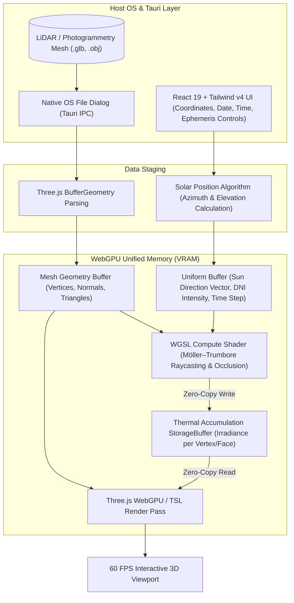

# Urban Solar-Thermal Simulator (Heliosim)


> A high-performance, native desktop application for simulating solar raycasting and generating thermal heatmaps on 3D urban environments.

## Project Overview

As urban density increases, placing solar panels and passive thermal systems efficiently becomes a significant engineering challenge due to the complex shadows cast by surrounding infrastructure (the "urban canyon" effect). 

The Urban Solar-Thermal Simulator addresses this problem by utilizing a custom WebGPU ray-tracer to simulate the exact path of the sun over a 3D photogrammetry mesh of a neighborhood or campus. By calculating millions of light-ray intersections in parallel, the software generates a precise thermal heatmap, visually highlighting the optimal locations for solar energy harvesting. 

This project demonstrates the application of high-performance computing to optimize the utilization of environmental resources in complex physical spaces.

## Key Features

* **Real-Time Raytracing:** Implements the Möller–Trumbore intersection algorithm within WGSL compute shaders to test millions of light rays against 3D building geometry at 60 frames per second.
* **Dynamic Solar Positioning:** Integrates the Solar Position Algorithm (SPA) to accurately calculate the sun's azimuth and elevation based on specific geographic latitudes, days of the year, and times of day.
* **Native OS File Handling:** Bypasses browser memory limitations via the Tauri native shell, allowing the ingestion of massive (100MB+) `.glb` or `.obj` 3D meshes generated from drone LiDAR or photogrammetry.
* **Interactive Heatmaps:** Visually maps thermal accumulation directly onto the 3D surface utilizing Three.js Node Materials (TSL).
* **Zero-Copy GPU Data Pipeline:** Mesh buffers, ray intersections, and accumulation passes reside entirely in unified VRAM, eliminating IPC transmission overhead.
* **Time-Lapse Solar Cumulative Analysis:** Computes integrated diurnal irradiance profiles ($kWh/m^2$) across selectable calendar periods (solstices, equinoxes, and annual aggregates).

## Zero-Copy WebGPU Architecture

Traditional desktop applications frequently suffer from heavy Inter-Process Communication (IPC) bottlenecks when transferring massive physics calculations from a backend systems language to a frontend renderer. 

This simulator eliminates that bottleneck by utilizing a zero-copy WebGPU pipeline:
1. **The Native Shell (Tauri):** Provides local file system access and OS-level window management without the overhead of heavy Rust compute logic.
2. **The Compute Engine (WGSL):** The React frontend passes the 3D mesh geometry into GPU memory. A WebGPU Compute Shader calculates the ray intersections in parallel and writes the thermal accumulation data directly to a GPU `StorageBuffer`.
3. **The Render Engine (Three.js):** The vertex and fragment shaders read from that exact `StorageBuffer` during the render pass to color the mesh. The arrays of thermal data never leave the GPU memory, enabling real-time performance on complex mathematical workloads.

### Data Flow Architecture



## Mathematical & Algorithmic Foundations

### 1. Möller–Trumbore Ray-Triangle Intersection
Ray occlusion tests determine whether incident direct sunlight reaches a surface point without being shaded by adjacent urban geometry. The ray is parameterized by origin $\vec{O}$ and normalized sun direction $\vec{D}$:

$$\vec{R}(t) = \vec{O} + t\vec{D}, \quad t > 0$$

For each triangle defined by vertices $(\vec{V}_0, \vec{V}_1, \vec{V}_2)$, edge vectors are given by $\vec{E}_1 = \vec{V}_1 - \vec{V}_0$ and $\vec{E}_2 = \vec{V}_2 - \vec{V}_0$. Using barycentric coordinates $(u, v)$:

$$\begin{bmatrix} t \\ u \\ v \end{bmatrix} = \frac{1}{\vec{P} \cdot \vec{E}_1} \begin{bmatrix} \vec{Q} \cdot \vec{E}_2 \\ \vec{P} \cdot \vec{T} \\ \vec{Q} \cdot \vec{D} \end{bmatrix}$$

where $\vec{P} = \vec{D} \times \vec{E}_2$, $\vec{T} = \vec{O} - \vec{V}_0$, and $\vec{Q} = \vec{T} \times \vec{E}_1$. A shadow intersection occurs if $t > \epsilon$, $u \ge 0$, $v \ge 0$, and $u + v \le 1$. In WGSL compute threads, each surface sample casts a shadow ray toward the sun to evaluate binary visibility:

$$\mathcal{V}(\vec{x}, \vec{L}) = \begin{cases} 1 & \text{if unoccluded} \\ 0 & \text{if shaded} \end{cases}$$

### 2. Solar Position Algorithm (SPA)
The sun vector $\vec{L}$ is computed using the NREL Solar Position Algorithm (SPA) based on:
- Latitude ($\phi$) and Longitude ($\lambda$)
- Day of Year ($n \in [1, 365]$) and Universal Coordinated Time (UTC)
- Solar Declination ($\delta$) and Hour Angle ($\omega$):

$$\sin(\alpha) = \sin(\phi)\sin(\delta) + \cos(\phi)\cos(\delta)\cos(\omega)$$

$$\cos(\gamma_s) = \frac{\sin(\alpha)\sin(\phi) - \sin(\delta)}{\cos(\alpha)\cos(\phi)}$$

where $\alpha$ is the solar elevation angle and $\gamma_s$ is the solar azimuth angle. The unit sun direction vector is:

$$\vec{L} = \begin{bmatrix} \cos(\alpha)\sin(\gamma_s) \\ \sin(\alpha) \\ \cos(\alpha)\cos(\gamma_s) \end{bmatrix}$$

### 3. Solar Irradiance & Thermal Heatmap Accumulation
The instantaneous direct irradiance $E_{\text{direct}}$ absorbed on an oriented patch with unit normal $\vec{N}$ is calculated via Lambert's cosine law:

$$E_{\text{direct}} = I_{\text{DNI}} \cdot \max(0, \vec{N} \cdot \vec{L}) \cdot \mathcal{V}(\vec{x}, \vec{L})$$

Cumulative thermal exposure ($kWh/m^2$) is integrated over time interval $[t_0, t_1]$:

$$Q_{\text{total}}(\vec{x}) = \int_{t_0}^{t_1} \left( E_{\text{direct}}(\vec{x}, t) + E_{\text{diffuse}}(\vec{x}, t) \right) dt$$

The resulting thermal scalar array stored in the GPU `StorageBuffer` is normalized and sampled by a false-color gradient (Turbo / Magma / Viridis) via Three.js Shading Language (TSL).

## Technology Stack

* **Window Manager & Native OS API:** Tauri v2 (Rust)
* **Frontend Framework:** React 19, TypeScript, Vite 6
* **Styling & Layout:** Tailwind CSS v4
* **3D & Compute Pipeline:** Three.js (WebGPURenderer), React Three Fiber (R3F), Drei
* **Compute Shaders:** WGSL (WebGPU Shading Language)
* **Build System & Package Manager:** Cargo (Rust) + npm / Node.js

## Project Structure

```
heliosim/
├── .github/
│   └── workflows/
│       └── tauri-build.yml       # CI workflow for Linux build verification
├── public/                       # Static public assets
├── src/
│   ├── assets/                   # UI icons and static graphics
│   ├── components/               # React UI components (controls, panels, HUD)
│   ├── core/                     # Simulation math, SPA calculator, geometry loader
│   ├── pages/                    # Main viewport and settings views
│   ├── shaders/                  # Custom WGSL compute and render shaders
│   │   ├── raytrace.wgsl         # Möller–Trumbore intersection compute kernel
│   │   └── heatmap.tsl           # Three.js Shading Language color mapping
│   ├── App.css                   # Global styles & Tailwind CSS v4 directives
│   ├── App.tsx                   # Main application root
│   ├── main.tsx                  # React DOM entrypoint
│   └── vite-env.d.ts             # Vite environment typings
├── src-tauri/
│   ├── capabilities/             # Tauri v2 security & permission capability configs
│   ├── icons/                    # Multi-resolution application icons
│   ├── src/
│   │   ├── lib.rs                # Tauri command handlers and runtime setup
│   │   └── main.rs               # Rust binary entry point
│   ├── Cargo.toml                # Rust dependencies and release profiles
│   └── tauri.conf.json           # Tauri app, window, and build configurations
├── index.html                    # Single-page HTML shell
├── package.json                  # Frontend dependencies and npm scripts
├── tsconfig.json                 # TypeScript compiler configurations
└── vite.config.ts                # Vite config with React, Tailwind v4, & Tauri HMR
```

## Local Development

### Prerequisites

Ensure you have the following installed on your system:
* **Node.js:** v18 or higher (v20+ recommended)
* **Rust & Cargo:** Stable toolchain (`rustup install stable`)
* **Hardware:** A GPU with WebGPU support (Vulkan, Metal, or Direct3D 12 backend)
* **OS-Specific Libraries (Linux only):**
  ```bash
  # Debian / Ubuntu / Mint
  sudo apt-get update && sudo apt-get install -y \
    libwebkit2gtk-4.1-dev \
    build-essential \
    curl \
    wget \
    file \
    libssl-dev \
    libgtk-3-dev \
    libayatana-appindicator3-dev \
    librsvg2-dev

  # Fedora / RHEL
  sudo dnf install \
    webkit2gtk4.1-devel \
    openssl-devel \
    gtk3-devel \
    libayatana-appindicator3-devel \
    librsvg2-devel
  ```

### Installation and Execution

1. **Clone the repository:**
   ```bash
   git clone https://github.com/LazyKaddu/Heliosim.git
   cd Heliosim
   ```

2. **Install frontend dependencies:**
   ```bash
   npm install
   ```

3. **Run in Desktop Mode (Tauri + Vite HMR):**
   ```bash
   npm run tauri dev
   ```
   *This starts the Vite local dev server at `http://localhost:1420` and launches the native Tauri desktop window with hot module replacement.*

4. **Run in Web-Only Mode (Browser Development):**
   ```bash
   npm run dev
   ```
   *Note: When running directly in a web browser, ensure your browser has WebGPU enabled (e.g., Chrome 113+, Edge 113+, or Firefox Nightly with `dom.webgpu.enabled`).*

### Building for Production

To create an optimized standalone native binary for your operating system:

```bash
npm run tauri build
```

The resulting distribution packages will be generated under `src-tauri/target/release/bundle/`:
* **Linux:** `.deb`, `.AppImage`
* **macOS:** `.dmg`, `.app`
* **Windows:** `.msi`, `.exe`

To compile only the static web bundle:
```bash
npm run build
```

## Supported Mesh Formats & Guidelines

For optimal simulation performance:
* **Formats:** Binary glTF (`.glb`), glTF (`.gltf`), and Wavefront OBJ (`.obj`).
* **Vertex Attributes:** Meshes must contain vertex positions and surface normals. If normal attributes are missing, they will be computed on geometry load.
* **Coordinate System:** Y-up, right-handed coordinate convention (Three.js standard).
* **Scale:** Real-world meter scale ($1.0 \text{ unit} = 1.0 \text{ meter}$) for accurate physical irradiance calculations ($W/m^2$).

## Performance Optimization

* **Zero-Copy GPU Storage:** Ray-casting compute shaders write simulation passes straight into shared VRAM `StorageBuffer`s, eliminating CPU-GPU memory bus round trips.
* **Aggressive Release Profile:** The Rust backend is compiled with Link-Time Optimization (`lto = true`), single codegen unit (`codegen-units = 1`), and binary stripping (`strip = true`) for minimal binary footprint and native execution speed.
* **Workgroup Sizing:** WGSL compute shaders utilize optimized `@workgroup_size(64, 1, 1)` or `@workgroup_size(128, 1, 1)` dispatch grids aligned with GPU hardware SIMD wavefronts.

## Roadmap

- [ ] GPU-accelerated Linear Bounding Volume Hierarchy (LBVH) traversal in WGSL for $10\text{M}+$ triangle scenes.
- [ ] Diffuse sky radiation calculation using the Perez All-Weather Sky Model.
- [ ] Export thermal analysis datasets to GeoJSON, CSV, and glTF metadata extensions.
- [ ] Building envelope energy consumption estimation based on surface thermal absorption.
- [ ] Automated sun-path diurnal animation export (MP4 / WebM recording).

## Contributing

Contributions, issues, and feature requests are welcome!

1. Fork the repository
2. Create your feature branch (`git checkout -b feature/solar-enhancement`)
3. Commit your changes (`git commit -m 'Add solar-enhancement'`)
4. Push to the branch (`git push origin feature/solar-enhancement`)
5. Open a Pull Request

## License

This project is licensed under the [MIT License](LICENSE).